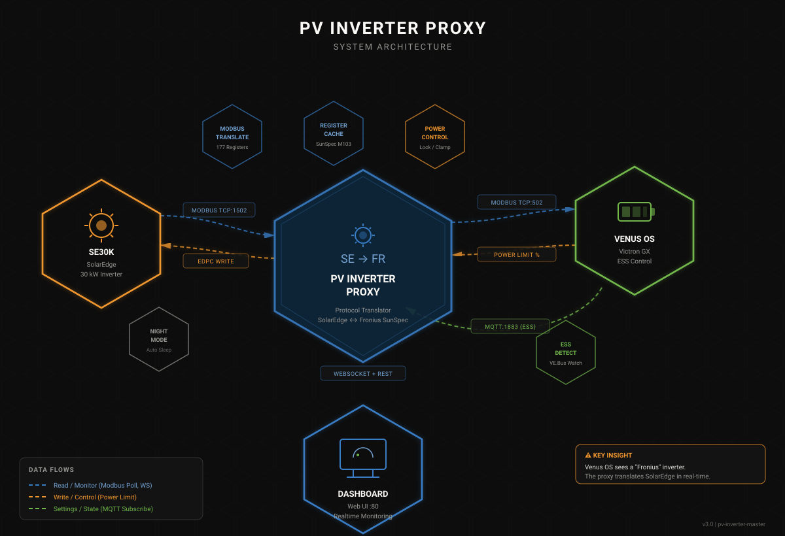

# PV-Inverter-Master

Multi-inverter aggregator that combines **SolarEdge**, **OpenDTU** (Hoymiles via DTU), **Hoymiles HMS** (built-in WLAN, no DTU needed), **Sungrow**, and **Shelly** devices into a single **Fronius-compatible SunSpec endpoint** for **Venus OS** (Victron). Venus OS natively discovers, monitors, and controls all inverters as one — including power limiting via DVCC/ESS.

Includes a dark-themed **web dashboard** with live monitoring, per-device management, power control, and Venus OS integration.

## Prerequisites

- **Debian 12+** / **Ubuntu 22.04+** (LXC, VM, or bare metal)
- **Python 3.12+** (installed automatically by installer)
- **Venus OS >= 3.7** (required for MQTT on LAN feature)
- All devices on the same LAN

## Installation

```bash
curl -fsSL https://raw.githubusercontent.com/meintechblog/pv-inverter-master-oss/main/install.sh | bash
```

This installs everything: Python venv, systemd service, default config. Edit the config afterwards:

```bash
nano /etc/pv-inverter-master/config.yaml
systemctl restart pv-inverter-master
```

### Update

Same command — the script detects an existing installation and updates in-place:

```bash
curl -fsSL https://raw.githubusercontent.com/meintechblog/pv-inverter-master-oss/main/install.sh | bash
```

## Supported Devices

| Device Type | Connection | Capabilities |
|-------------|-----------|--------------|
| **SolarEdge** | Modbus TCP | Full: polling, power limiting, 3-phase AC + DC |
| **OpenDTU** (Hoymiles via DTU) | REST API | Full: polling (≥5 s floor, per-(host,serial) cache, `?inv=<serial>` for newer FW, `data_age>60 s` stale gate), power limiting, DC channels |
| **Hoymiles HMS** (built-in WLAN) | TCP protobuf :10081 | Polling (≥30 s floor, night-mode backoff), power limiting (EEPROM-rate-limited), DC channels, on/off/restart — see [docs/hoymiles-integration.md](docs/hoymiles-integration.md) |
| **Sungrow** | Modbus TCP | Full: polling, power limiting, 3-phase AC + DC, WiNet-S remote reboot (UI button) for hung-Modbus-slot recovery |
| **Shelly** (Gen1/Gen2/Gen3) | HTTP REST | Polling, relay on/off, mDNS discovery |

All devices are aggregated into a single virtual Fronius inverter that Venus OS sees and controls.

## Features

- **Multi-Inverter Aggregation** — SolarEdge + OpenDTU + Shelly combined into one SunSpec endpoint
- **Virtual Fronius Inverter** — Venus OS auto-detects as "Fronius" with aggregated power from all devices
- **Per-Device Dashboards** — Power gauge, AC/DC tables, connection status, device-specific controls
- **Shelly Plugin** — Gen1/Gen2/Gen3 auto-detection, relay on/off, mDNS LAN discovery
- **Add Device Flow** — Add straight from a location's sidebar `+` (location pre-selected, still editable), type picker, auto-probe, LAN discovery
- **Power Control** — Per-device power limiting with priority ordering (waterfall algorithm)
- **Venus OS Integration** — MQTT connection, ESS settings, grid power, limiter state
- **Live Dashboard** — Power gauge, sparkline (60 min), peak statistics, real-time WebSocket updates
- **Config Page** — Per-device settings with dirty tracking, save/cancel, live connection status, inline poll-health card (last successful poll relative-time + last error)
- **Sidebar Health Tooltip** — Hover any device row to see `connection_state`, last successful poll relative-time, and last poll error in a native tooltip — at-a-glance visibility for the 12+ devices typical in a production setup
- **WiNet-S Reboot Button** (Sungrow) — One-click remote reboot of the Sungrow WiNet-S communication module via its WebSocket-login + `POST /system/maintenance` API. Fixes the recurring "Modbus slot hangs every few weeks" failure mode (TCP port 502 accepts connections but Modbus frames are dropped). German confirm dialog, button rendered only when the plugin advertises `supports_reboot=true` via duck-typed `async def reboot()` — capability flag in `/api/devices` payload so other plugins can opt in without touching the base ABC.
- **Strings & Panels Inventory** — Per-string panel groups (`count × Wp`, optional brand/model); multiple panel types per string supported (e.g. SolarEdge string with mixed-Wp panels); total Wp auto-summed
- **Register Viewer** — Raw SunSpec registers per device with decoded values
- **Smart Notifications** — Toast alerts for overrides, faults, temperature warnings, night mode
- **Phasen-Detective** — Auto-detect which AC phase (L1/L2/L3) a single-phase inverter is wired to by throttling it briefly and watching for the per-phase grid power Δ. Single-throttle algorithm with common-mode subtraction (removes Multiplus background-drift) and peak-Δ-across-windows (catches the transient before Multiplus rebalances). Verify mode runs N=3 with cooldown-respecting gaps for consensus. Auto-applies on first detection, surfaces a mismatch + manual override on re-verification. See [docs/phase-detective.md](docs/phase-detective.md).
- **ATS-Awareness** — For installations with a central Auto-Transfer-Switch (grid-parallel ↔ island mode), subscribes to the switch state via MQTT and surfaces it as a coloured badge in the UI. Phasen-Detective records the active topology at probe time so a later verification can warn about a topology change.

## Architecture

<p align="center">
  
</p>

The proxy sits between multiple inverters and Venus OS, aggregating and translating protocols in real-time:

| Path | Protocol | Purpose |
|------|----------|---------|
| SolarEdge **->** Proxy | Modbus TCP :1502 | Poll inverter data (power, voltage, temperature) |
| OpenDTU **->** Proxy | HTTP REST | Poll Hoymiles micro-inverter data |
| Shelly **->** Proxy | HTTP REST | Poll power/energy, control relay |
| Proxy **->** Venus OS | Modbus TCP :502 | Serve aggregated Fronius SunSpec registers |
| Venus OS **->** Proxy | Modbus Write | Send power limit commands (ESS feed-in control) |
| Proxy **->** Devices | Modbus/HTTP | Forward power limits to individual inverters |
| Venus OS **->** Proxy | MQTT :1883 | Subscribe to ESS settings, grid power, limiter state |
| Proxy **->** Browser | WebSocket + REST :80 | Live dashboard with real-time updates |

## Dashboard

Access at `http://<proxy-ip>` (port 80).

**Per-Device Pages:**
- **Dashboard** — Power gauge, AC output (single-phase or 3-phase), DC input (if available), connection status, device controls
- **Config** — Device-specific settings (host, credentials, rated power, throttle order)
- **Registers** — Raw SunSpec register viewer with device-specific column labels

**Global:**
- **Add Device** — Every location group in the sidebar has a `+` that opens the flow with that location pre-selected (editable, or "no location"); type picker, auto-probe, LAN discovery
- **Venus OS** — Connection status, ESS settings, MQTT setup

## Management

```bash
# Service status
systemctl status pv-inverter-master

# Live logs
journalctl -u pv-inverter-master -f

# Restart
systemctl restart pv-inverter-master

# Stop
systemctl stop pv-inverter-master
```

## Tech Stack

- **Python 3.12**, pymodbus 3.8+, aiohttp, paho-mqtt, structlog, PyYAML, zeroconf
- **Frontend**: Vanilla JS, CSS3 (zero dependencies, no build step)
- **Deployment**: systemd service on Debian/Ubuntu (LXC recommended)

## Development

```bash
git clone https://github.com/meintechblog/pv-inverter-master-oss.git
cd pv-inverter-master
python3 -m venv .venv && source .venv/bin/activate
pip install -e ".[dev]"
pytest
```

## License

[Energy Community License (ECL-1.0)](LICENSE) — Free to use, modify, and redistribute. Commercial resale of the software itself is not permitted. See [LICENSE](LICENSE) for details.
